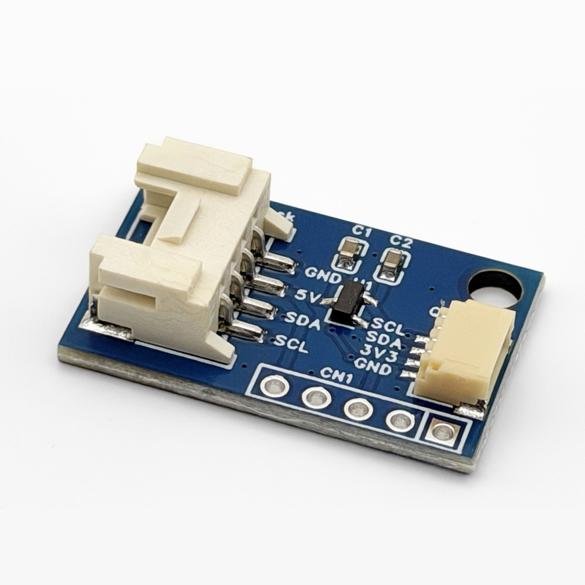
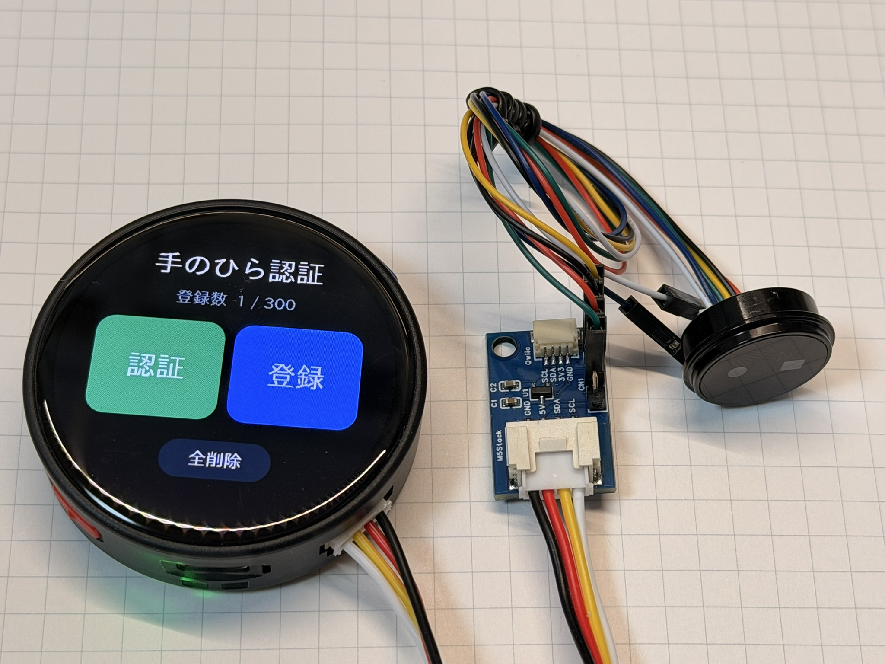
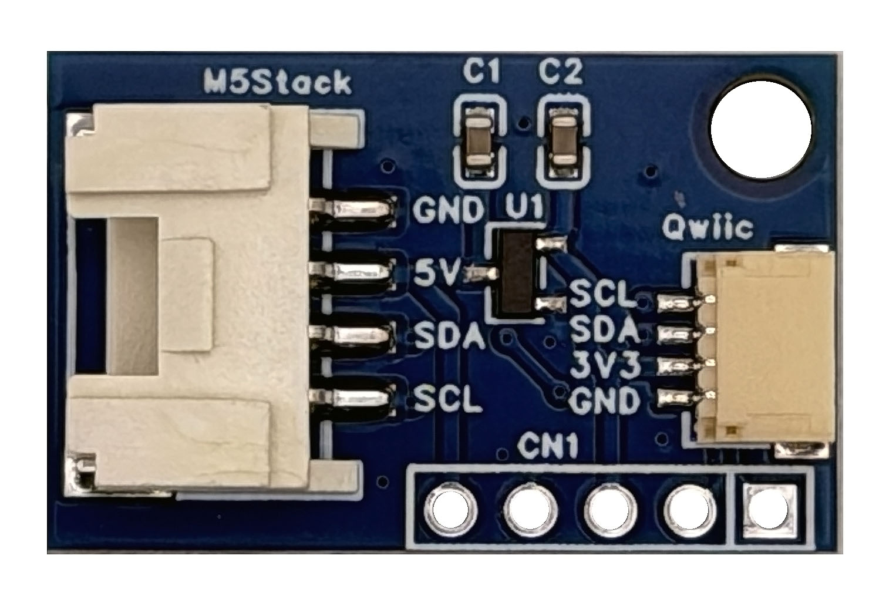
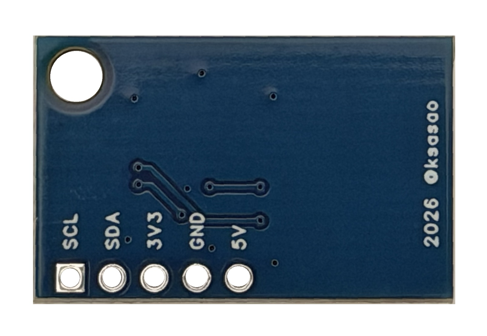
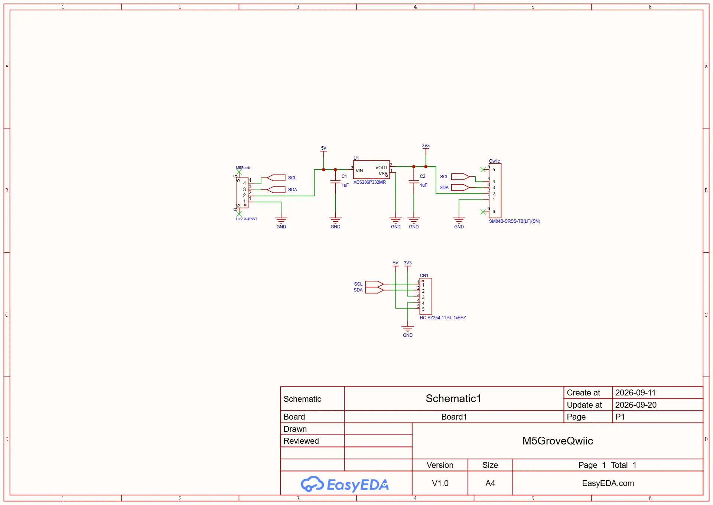
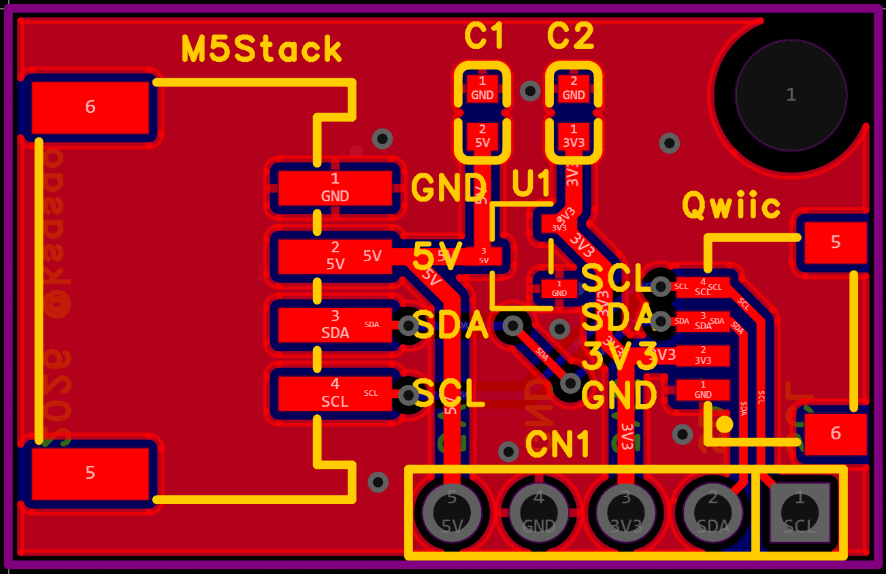
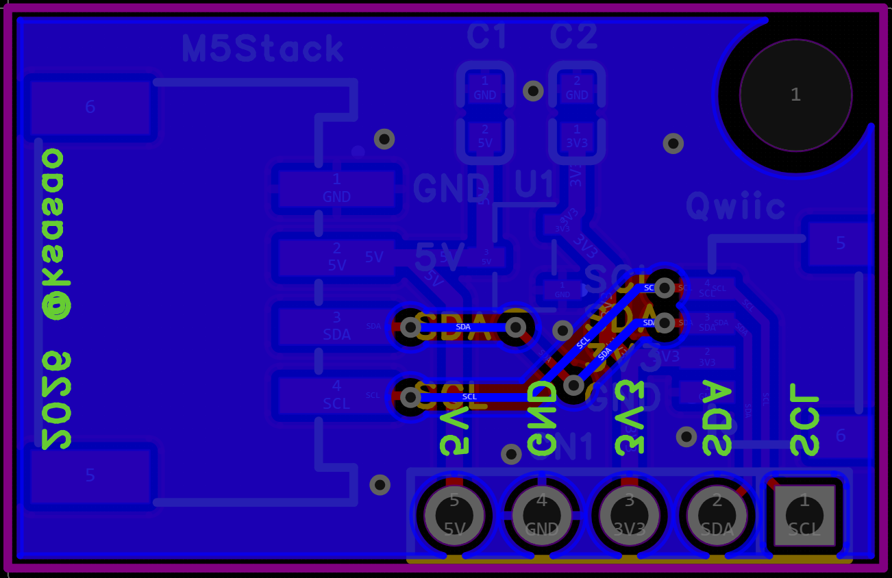

# M5Stack用 Grove - Qwiic 変換アダプタ

M5Stack の Grove ポート（M5Stack の表記では HY2.0-4P の PORT.A、I²C）に、SparkFun の Qwiic 規格の I²C 機器をつなぐための変換基板です。

※本製品は M5Stack の公式製品ではありません。

- Grove 側の 5V から、3.3V レギュレータ（XC6206P332MR）で Qwiic 用の 3.3V を作ります。
- SDA / SCL は、Grove と Qwiic のあいだをそのままつないでいます（レベル変換はありません）。
- 2.54mm ピッチのスルーホール（CN1）にピンヘッダをはんだ付けすると、ジャンパワイヤやピンソケット付きのケーブルでも機器をつなげます。DFRobot のセンサなどに付属する、ピンソケット（メス）付きのケーブルも使えます。
- M3 ネジなどで固定できる取り付け穴があります。

## 内容物

- 変換基板 × 1
- ピンヘッダ（1×5、2.54mm ピッチ）× 1（未はんだ付け）

ケーブルは付属しません。Grove ケーブルと Qwiic ケーブルは別途ご用意ください。

## 仕様

| 項目 | 内容 |
|---|---|
| 入力側コネクタ | Grove 互換 4ピン（HY2.0-4P、2.0mm ピッチ） |
| 出力側コネクタ | Qwiic 互換 4ピン（JST SH 1.0mm ピッチ、SM04B-SRSS-TB） |
| ピンヘッダ用スルーホール | CN1、1×5、2.54mm ピッチ |
| 入力電圧 | 5V（Grove の 5V ピンから供給） |
| Qwiic 側の電源 | 3.3V（XC6206P332MR、最大出力電流 200mA） |
| 信号 | I²C（SDA / SCL）。レベル変換なし、プルアップ抵抗なし |
| 基板サイズ | 約 25.5 × 16.5 × 6.7 mm |
| 取り付け穴 | 1か所（M3 用） |

## つなぎかた

1. M5Stack 側は、Grove ケーブルで基板の「M5Stack」と書かれたコネクタにつなぎます。
2. Qwiic 機器は、Qwiic ケーブルで「Qwiic」と書かれたコネクタにつなぎます。
3. ピンソケット付きの機器は、CN1 にピンヘッダをはんだ付けし、ジャンパワイヤでつなぎます（上の写真）。CN1 には 3.3V と 5V の両方が出ているので、機器に合わせて選べます。

M5Stack 側のプログラムは、PORT.A の I²C として扱います。この基板にはマイコンも I²C アドレスもないので、ライブラリや設定は不要です。

## ピン配置

| ピン | Grove（HY2.0-4P） | Qwiic | CN1（ピンヘッダ） |
|---|---|---|---|
| 1 | GND | GND | SCL（角ランド） |
| 2 | 5V | 3V3 | SDA |
| 3 | SDA | SDA | 3V3 |
| 4 | SCL | SCL | GND |
| 5 | — | — | 5V |

M5Stack 製品に付属する Grove 互換ケーブルは、黒＝GND、赤＝5V、黄＝SDA、白＝SCL です。Seeed Studio の Grove ケーブルは、黄＝SCL、白＝SDA で、黄と白の色が逆です。どちらも同じピンどうしをつなぐケーブルなので、そのまま使えます。

## ご注意

- **I²C の信号はレベル変換していません。** SDA / SCL の電圧は、M5Stack 側（3.3V）のままです。CN1 の 5V ピンは電源用です。5V の信号で動く I²C 機器をつなぐと、M5Stack 本体を壊すおそれがあります。
- **プルアップ抵抗はありません。** 通常は M5Stack 本体や Qwiic 機器側のプルアップ抵抗で動きます。どちらにもない場合は、外付けしてください。
- 3.3V の電源は、レギュレータの定格（200mA）を超えないようにしてください。消費電流の大きい機器は、CN1 の 5V から取るか、別の電源を使ってください。
- 同じ I²C バスにつなぐ機器どうしで、I²C アドレスが重ならないようにしてください。

## 回路図

| 部品 | 型番 | 内容 |
|---|---|---|
| M5Stack | HY2.0-4PWT | Grove 互換コネクタ |
| Qwiic | SM04B-SRSS-TB(LF)(SN) | Qwiic 互換コネクタ |
| U1 | XC6206P332MR | 5V → 3.3V レギュレータ |
| C1, C2 | 1µF | レギュレータの入力・出力コンデンサ |
| CN1 | 1×5 ピンヘッダ（2.54mm） | 5V / GND / 3V3 / SDA / SCL |

### 基板

| 表面 | 裏面 |
|---|---|
|  |  |

設計データは [OSHWLab](https://oshwlab.com/ksasao/project_obxzetyv) で公開しています。

## お問い合わせ

商品の内容や使い方のご質問、製造に起因する欠品・破損（初期不良）は、[お問い合わせフォーム](https://ksasao.github.io/p/contact)からご連絡ください。

ご注文、お支払い、配送中の破損については、ご購入先のショップにお問い合わせください。

## ライセンス

ハードウェアの設計データは [CERN-OHL-P-2.0](https://ohwr.org/cern_ohl_p_v2.txt) で公開しています。

## 更新履歴

| 日付 | 内容 |
|---|---|
| 2026-09-20 | V1.0 |
